# Тестирование. Задание 4. Декомпозиция, матрица покрытия и отчёт о тестировании

Объект тестирования: учебное приложение салона ÉLAIRE (React + Vite, имитационный сервер).
Версия: локальная сборка из папки frontend-4-complete.
Дата тестирования: 13.11.2026.

## 1. Декомпозиция функционала

### 1.1. Карта функционала

Карта построена по уровням «модуль - компонент - атомарные действия». На схеме показаны модули и компоненты, атомарные действия каждого компонента перечислены в таблице 1.2. Визуальная схема выполнена в Mermaid, она открывается на GitHub и может быть перенесена в draw.io.

```mermaid
flowchart TD
    ROOT["ÉLAIRE"]
    ROOT --> HOME["Главная"]
    ROOT --> SERVICES["Выбор услуги"]
    ROOT --> BOOKING["Выбор даты и времени"]
    ROOT --> CONFIRM["Подтверждение записи"]
    ROOT --> COMMON["Общие компоненты"]
    ROOT --> API["Серверный API"]

    HOME --> HERO["Hero"]
    HOME --> POPULAR["Популярные услуги"]
    HOME --> MASTERS["Наши мастера"]

    SERVICES --> SIDEBAR["Сайдбар категорий"]
    SERVICES --> LIST["Список услуг"]
    SERVICES --> STEP["Индикатор шагов"]

    BOOKING --> CAL["Календарь"]
    BOOKING --> SLOTS["Слоты времени"]
    BOOKING --> BAR["Нижняя панель"]

    CONFIRM --> DETAILS["Детали визита"]
    CONFIRM --> FORM["Контактные данные"]
    CONFIRM --> MODAL["Модальное окно"]

    COMMON --> HEADER["Header и Footer"]
    COMMON --> STATES["LoadingState и EmptyState"]
    COMMON --> MODALBASE["Modal"]

    API --> CAT["GET /api/categories"]
    API --> SRV["GET /api/categories/:id/services"]
    API --> SLOTAPI["GET /api/services/:id/slots"]
    API --> TODAY["GET /api/booking/today"]
    API --> POST["POST /api/booking"]
```

### 1.2. Модули, компоненты и атомарные действия

| Модуль | Компонент | Атомарные действия | Требования |
|---|---|---|---|
| Главная | Hero | Открыть главную, нажать «Записаться на услугу», нажать «Выбрать мастера» | REQ-01, REQ-02, REQ-03 |
| Главная | PopularServices | Показать карточки популярных услуг | REQ-04 |
| Главная | OurMasters | Показать карточки мастеров | REQ-05 |
| Выбор услуги | Sidebar, CategoryItem | Загрузить категории, показать количество услуг, выбрать категорию, подсветить активную | REQ-06, REQ-07 |
| Выбор услуги | ServicesList, ServiceRow | Загрузить услуги категории, показать название, описание, длительность, цену, нажать «Выбрать» | REQ-08, REQ-09, REQ-10, REQ-11 |
| Выбор услуги | StepIndicator | Показать текущий шаг | проверяется в CH-12 |
| Выбор даты и времени | Calendar, CalendarHeader, CalendarGrid | Загрузить today, показать месяц, переключить месяц, выбрать день, заблокировать прошедшие дни | REQ-13, REQ-18 |
| Выбор даты и времени | TimeSlots | Загрузить слоты, показать доступные и занятые, выбрать время, показать пустой день | REQ-14, REQ-19 |
| Выбор даты и времени | BookingBottomBar | Показать выбранную дату и время, нажать «Далее», показать предупреждение без времени | REQ-15, REQ-16, REQ-17 |
| Выбор даты и времени | Кнопка «Назад» | Вернуться на экран выбора услуги | REQ-21 |
| Подтверждение записи | BookingDetails | Показать услугу, дату, время, мастера, длительность, цену | REQ-22, REQ-30 |
| Подтверждение записи | ContactForm | Ввести имя, телефон, комментарий, отправить форму, проверить поля, заблокировать форму на время отправки, показать ошибку | REQ-23, REQ-25, REQ-26, REQ-27, REQ-28, REQ-29 |
| Подтверждение записи | Кнопка «Назад» | Вернуться на экран выбора даты и времени | REQ-31 |
| Подтверждение записи | ConfirmationModal, Modal | Показать успех, закрыть окно, вернуться на главную | REQ-24 |
| Общие компоненты | Header, Footer, LoadingState, EmptyState, Modal | Переходы, заглушки загрузки, сообщения об ошибках, модальные окна | REQ-10, REQ-11, REQ-29 |
| Серверный API | Vite middleware, database.js | Отдать категории, услуги, слоты, today, сохранить запись, проверить данные, обновить занятость слота | REQ-32, REQ-33, REQ-34, REQ-35, REQ-36, REQ-37, REQ-38, REQ-39 |

### 1.3. Требования по модулям

Маркер 🟡 означает новое требование, которого не было в задании 1.

#### Модуль «Главная»

| ID | Требование | Новое |
|---|---|---|
| REQ-01 | Система должна отображать главную страницу с секциями Hero, «Популярные услуги» и «Наши мастера», когда клиент открывает приложение. | 🟡 |
| REQ-02 | Система должна переходить на экран выбора услуги, когда клиент нажимает «Записаться на услугу». | 🟡 |
| REQ-03 | Система должна открывать выбор мастера, когда клиент нажимает «Выбрать мастера». | 🟡 |
| REQ-04 | Система должна отображать популярные услуги с названием, ценой и длительностью, когда главная страница загружена. | 🟡 |
| REQ-05 | Система должна отображать карточки мастеров с именем, специализацией и рейтингом, когда главная страница загружена. | 🟡 |

#### Модуль «Выбор услуги»

| ID | Требование | Новое |
|---|---|---|
| REQ-06 | Система должна отображать список категорий услуг, когда клиент открывает экран выбора услуги. |  |
| REQ-07 | Система должна автоматически выбирать первую категорию, когда список категорий успешно загружен. |  |
| REQ-08 | Система должна отображать список услуг выбранной категории с названием, описанием, длительностью и ценой, когда клиент выбирает категорию. |  |
| REQ-09 | Система должна переходить к выбору даты и времени, когда клиент нажимает «Выбрать» у услуги. |  |
| REQ-10 | Система должна показывать заглушку «Загрузка...», когда категории или услуги ещё загружаются. | 🟡 |
| REQ-11 | Система должна показывать сообщение об ошибке, когда категории или услуги не удалось загрузить. | 🟡 |
| REQ-12 | Система должна возвращать на главную, когда клиент нажимает «Назад» на экране выбора услуги. | 🟡 |

#### Модуль «Выбор даты и времени»

| ID | Требование | Новое |
|---|---|---|
| REQ-13 | Система должна отображать календарь текущего месяца и блокировать прошедшие даты, когда клиент открывает экран выбора даты и времени. |  |
| REQ-14 | Система должна отображать доступные и занятые слоты, когда клиент выбирает день в календаре. |  |
| REQ-15 | Система должна сбрасывать выбранное время, когда клиент меняет день. |  |
| REQ-16 | Система должна показывать предупреждение «Пожалуйста, выберите время» и не переходить дальше, когда клиент нажимает «Далее» без выбранного времени. |  |
| REQ-17 | Система должна переходить на экран подтверждения, когда клиент выбирает доступное время и нажимает «Далее». |  |
| REQ-18 | Система должна переключать месяц календаря, когда клиент нажимает стрелки «‹» и «›». | 🟡 |
| REQ-19 | Система должна показывать сообщение «В этот день нет доступного времени», когда слотов нет. | 🟡 |
| REQ-20 | Система должна сохранять выбранные услугу, дату и время, когда клиент возвращается с экрана подтверждения. | 🟡 |
| REQ-21 | Система должна возвращать на экран выбора услуги, когда клиент нажимает «Назад» на экране выбора даты и времени. | 🟡 |

#### Модуль «Подтверждение записи»

| ID | Требование | Новое |
|---|---|---|
| REQ-22 | Система должна отображать услугу, дату, время, мастера, длительность и цену, когда клиент открывает экран подтверждения. |  |
| REQ-23 | Система должна отправлять запись на сервер, когда клиент нажимает «Подтвердить запись». |  |
| REQ-24 | Система должна показывать модальное окно «Запись подтверждена» и возвращать на главную, когда сервер успешно сохранил запись. |  |
| REQ-25 | Система должна проверять, что имя заполнено, содержит только кириллицу и имеет длину от 2 до 40 символов, когда клиент отправляет форму. | 🟡 |
| REQ-26 | Система должна проверять, что телефон заполнен, соответствует формату +7 (XXX) XXX-XX-XX, содержит 11 цифр и начинается с +7, когда клиент отправляет форму. | 🟡 |
| REQ-27 | Система должна блокировать отправку формы и показывать сообщение об ошибке под полем, когда имя или телефон не прошли валидацию. | 🟡 |
| REQ-28 | Система должна блокировать кнопку «Подтвердить запись» и показывать «Отправка...», когда запись отправляется на сервер. | 🟡 |
| REQ-29 | Система должна показывать сообщение об ошибке, когда сервер не сохранил запись. | 🟡 |
| REQ-30 | Система должна отображать мастера, выбранного клиентом, а не фиксированное значение. | 🟡 |
| REQ-31 | Система должна возвращать на экран выбора даты и времени, когда клиент нажимает «Назад» на экране подтверждения. | 🟡 |

#### Модуль «Серверный API»

| ID | Требование | Новое |
|---|---|---|
| REQ-32 | Система должна возвращать список категорий с количеством услуг, когда клиент запрашивает GET /api/categories. | 🟡 |
| REQ-33 | Система должна возвращать услуги категории, когда клиент запрашивает GET /api/categories/{id}/services. | 🟡 |
| REQ-34 | Система должна возвращать слоты на дату, когда клиент запрашивает GET /api/services/{id}/slots. | 🟡 |
| REQ-35 | Система должна возвращать текущую дату, когда клиент запрашивает GET /api/booking/today. | 🟡 |
| REQ-36 | Система должна сохранять запись, когда клиент отправляет POST /api/booking. | 🟡 |
| REQ-37 | Система должна отклонять запись с невалидными данными и возвращать код 400, когда клиент отправляет POST /api/booking. | 🟡 |
| REQ-38 | Система должна помечать слот занятым после успешной записи. | 🟡 |
| REQ-39 | Система должна отклонять повторную запись на занятый слот. | 🟡 |

### 1.4. Связь с требованиями из задания 1

Требования из задания 1 сохранены в общем списке и получили новые сквозные номера. Соответствие старое - новое:

| Задание 1 | Задание 4 | Тема |
|---|---|---|
| REQ-01 | REQ-06 | Список категорий услуг |
| REQ-02 | REQ-07 | Автовыбор первой категории |
| REQ-03 | REQ-08 | Список услуг выбранной категории |
| REQ-04 | REQ-09 | Переход по кнопке «Выбрать» |
| REQ-05 | REQ-13 | Календарь и блокировка прошедших дат |
| REQ-06 | REQ-14 | Доступные и занятые слоты |
| REQ-07 | REQ-15 | Сброс времени при смене дня |
| REQ-08 | REQ-16 | Предупреждение без выбранного времени |
| REQ-09 | REQ-17 | Переход на подтверждение |
| REQ-10 | REQ-22 | Детали визита |
| REQ-11 | REQ-23 | Отправка записи на сервер |
| REQ-12 | REQ-24 | Модальное окно и возврат на главную |

Остальные 27 требований (REQ-01...REQ-05, REQ-10...REQ-12, REQ-18...REQ-21, REQ-25...REQ-39) добавлены в задании 4 после прохода по карте функционала.

## 2. Матрица покрытия (traceability matrix)

### 2.1. Легенда

- 🟡 - новое требование или требование, которое до задания 4 не было покрыто тестами.
- ✅ - требование покрыто хотя бы одним тестом или пунктом чек-листа.
- ❌ - требование не покрыто тестами.
- PASS - тест пройден, FAIL - тест не пройден.
- CH-01...CH-12 - пункты чек-листа из задания 2.1.
- TC-01...TC-37 - тест-кейсы из заданий 2.1, 3.1, 3.2 и добавленные в задании 4.

### 2.2. Матрица

| ID | Формулировка требования | ID тестов | Покрыто | Результат |
|---|---|---|---|---|
| 🟡 REQ-01 | Система должна отображать главную страницу с секциями Hero, «Популярные услуги» и «Наши мастера», когда клиент открывает приложение. | TC-33 | ✅ | PASS |
| 🟡 REQ-02 | Система должна переходить на экран выбора услуги, когда клиент нажимает «Записаться на услугу». | CH-01, TC-01 | ✅ | PASS |
| 🟡 REQ-03 | Система должна открывать выбор мастера, когда клиент нажимает «Выбрать мастера». | TC-23 | ✅ | FAIL |
| 🟡 REQ-04 | Система должна отображать популярные услуги с названием, ценой и длительностью, когда главная страница загружена. | TC-33 | ✅ | PASS |
| 🟡 REQ-05 | Система должна отображать карточки мастеров с именем, специализацией и рейтингом, когда главная страница загружена. | TC-33 | ✅ | PASS |
| REQ-06 | Система должна отображать список категорий услуг, когда клиент открывает экран выбора услуги. | CH-01, CH-03, TC-25 | ✅ | PASS |
| REQ-07 | Система должна автоматически выбирать первую категорию, когда список категорий успешно загружен. | CH-04 | ✅ | PASS |
| REQ-08 | Система должна отображать список услуг выбранной категории с названием, описанием, длительностью и ценой, когда клиент выбирает категорию. | CH-05, CH-07, TC-18 | ✅ | PASS |
| REQ-09 | Система должна переходить к выбору даты и времени, когда клиент нажимает «Выбрать» у услуги. | CH-11, TC-01 | ✅ | PASS |
| 🟡 REQ-10 | Система должна показывать заглушку «Загрузка...», когда категории или услуги ещё загружаются. | CH-02, CH-08, TC-34 | ✅ | PASS |
| 🟡 REQ-11 | Система должна показывать сообщение об ошибке, когда категории или услуги не удалось загрузить. | CH-08, TC-35 | ✅ | PASS |
| 🟡 REQ-12 | Система должна возвращать на главную, когда клиент нажимает «Назад» на экране выбора услуги. | CH-10, TC-19 | ✅ | PASS |
| REQ-13 | Система должна отображать календарь текущего месяца и блокировать прошедшие даты, когда клиент открывает экран выбора даты и времени. | TC-16 | ✅ | PASS |
| REQ-14 | Система должна отображать доступные и занятые слоты, когда клиент выбирает день в календаре. | TC-01, TC-15 | ✅ | PASS |
| 🟡 REQ-15 | Система должна сбрасывать выбранное время, когда клиент меняет день. | TC-15 | ✅ | PASS |
| 🟡 REQ-16 | Система должна показывать предупреждение «Пожалуйста, выберите время» и не переходить дальше, когда клиент нажимает «Далее» без выбранного времени. | TC-14 | ✅ | PASS |
| REQ-17 | Система должна переходить на экран подтверждения, когда клиент выбирает доступное время и нажимает «Далее». | TC-01 | ✅ | PASS |
| 🟡 REQ-18 | Система должна переключать месяц календаря, когда клиент нажимает стрелки «‹» и «›». | TC-17 | ✅ | PASS |
| 🟡 REQ-19 | Система должна показывать сообщение «В этот день нет доступного времени», когда слотов нет. | TC-37 | ✅ | PASS |
| 🟡 REQ-20 | Система должна сохранять выбранные услугу, дату и время, когда клиент возвращается с экрана подтверждения. | TC-20 | ✅ | FAIL |
| 🟡 REQ-21 | Система должна возвращать на экран выбора услуги, когда клиент нажимает «Назад» на экране выбора даты и времени. | TC-36 | ✅ | PASS |
| REQ-22 | Система должна отображать услугу, дату, время, мастера, длительность и цену, когда клиент открывает экран подтверждения. | TC-01 | ✅ | PASS |
| REQ-23 | Система должна отправлять запись на сервер, когда клиент нажимает «Подтвердить запись». | TC-01, TC-29 | ✅ | PASS |
| REQ-24 | Система должна показывать модальное окно «Запись подтверждена» и возвращать на главную, когда сервер успешно сохранил запись. | TC-01 | ✅ | PASS |
| 🟡 REQ-25 | Система должна проверять, что имя заполнено, содержит только кириллицу и имеет длину от 2 до 40 символов, когда клиент отправляет форму. | TC-03, TC-09, TC-10, TC-11, TC-12, TC-13 | ✅ | FAIL |
| 🟡 REQ-26 | Система должна проверять, что телефон заполнен, соответствует формату +7 (XXX) XXX-XX-XX, содержит 11 цифр и начинается с +7, когда клиент отправляет форму. | TC-02, TC-04, TC-05, TC-06, TC-07, TC-08 | ✅ | FAIL |
| 🟡 REQ-27 | Система должна блокировать отправку формы и показывать сообщение об ошибке под полем, когда имя или телефон не прошли валидацию. | TC-02, TC-03, TC-04, TC-05, TC-06, TC-07, TC-09, TC-12, TC-13 | ✅ | FAIL |
| 🟡 REQ-28 | Система должна блокировать кнопку «Подтвердить запись» и показывать «Отправка...», когда запись отправляется на сервер. | TC-21 | ✅ | PASS |
| 🟡 REQ-29 | Система должна показывать сообщение об ошибке, когда сервер не сохранил запись. | TC-22 | ✅ | PASS |
| 🟡 REQ-30 | Система должна отображать мастера, выбранного клиентом, а не фиксированное значение. | TC-24 | ✅ | FAIL |
| 🟡 REQ-31 | Система должна возвращать на экран выбора даты и времени, когда клиент нажимает «Назад» на экране подтверждения. | TC-20 | ✅ | FAIL |
| 🟡 REQ-32 | Система должна возвращать список категорий с количеством услуг, когда клиент запрашивает GET /api/categories. | TC-25 | ✅ | PASS |
| 🟡 REQ-33 | Система должна возвращать услуги категории, когда клиент запрашивает GET /api/categories/{id}/services. | TC-26 | ✅ | PASS |
| 🟡 REQ-34 | Система должна возвращать слоты на дату, когда клиент запрашивает GET /api/services/{id}/slots. | TC-27 | ✅ | PASS |
| 🟡 REQ-35 | Система должна возвращать текущую дату, когда клиент запрашивает GET /api/booking/today. | TC-28 | ✅ | PASS |
| 🟡 REQ-36 | Система должна сохранять запись, когда клиент отправляет POST /api/booking. | TC-29 | ✅ | PASS |
| 🟡 REQ-37 | Система должна отклонять запись с невалидными данными и возвращать код 400, когда клиент отправляет POST /api/booking. | TC-30 | ✅ | FAIL |
| 🟡 REQ-38 | Система должна помечать слот занятым после успешной записи. | TC-32 | ✅ | FAIL |
| 🟡 REQ-39 | Система должна отклонять повторную запись на занятый слот. | TC-31 | ✅ | FAIL |

### 2.3. Анализ пробелов

До задания 4 тесты из заданий 2 и 3 покрывали 13 из 39 требований: REQ-06, REQ-07, REQ-08, REQ-09, REQ-13, REQ-14, REQ-17, REQ-22, REQ-23, REQ-24 (сквозной тест-кейс TC-01), а также REQ-25, REQ-26, REQ-27 (классы, граничные значения и таблица решений из задания 3). Остальные 26 требований были без тестов, из них 24 новых и 2 старых (REQ-15 и REQ-16).

Пробелы и способы их закрытия:

| Группа требований | Пробел | Чем закрыт |
|---|---|---|
| REQ-01...REQ-05, главная страница | Не было ни одного теста | TC-33, TC-23 |
| REQ-10...REQ-12, загрузка, ошибки и возврат | Не было тестов состояний и навигации | TC-34, TC-35, TC-19 |
| REQ-15, REQ-16, сброс времени и предупреждение | Требования были, но отдельных тестов не было | TC-15, TC-14 |
| REQ-18...REQ-21, дополнительные сценарии календаря | Не было тестов переключения месяца, пустых слотов и сохранения выбора | TC-17, TC-37, TC-20, TC-36 |
| REQ-25...REQ-27, валидация формы | Были только тесты из задания 3 без привязки к требованиям | TC-02, TC-03, TC-04, TC-05, TC-06, TC-07, TC-09, TC-10, TC-11, TC-12, TC-13 |
| REQ-28...REQ-31, состояние отправки, ошибка сервера, мастер, возврат | Не было тестов | TC-21, TC-22, TC-24, TC-20 |
| REQ-32...REQ-39, API и целостность данных | Не было тестов API | TC-25, TC-26, TC-27, TC-28, TC-29, TC-30, TC-31, TC-32 |

Итог: после добавления тестов покрытие составляет 39 из 39 требований. Строки, которые были новыми или не покрытыми до задания 4, отмечены маркером 🟡: 27 новых требований и 2 старых требования без тестов (REQ-15, REQ-16), всего 29 строк.

### 2.4. Итоги покрытия

| Показатель | Значение |
|---|---|
| Всего требований | 39 |
| Покрыто тестами | 39 |
| Не покрыто | 0 |
| Новых требований | 27 |
| Требований, которые были без тестов до задания 4 | 26 |
| Строк, отмеченных 🟡 | 29 |
| Требований с пройденными тестами | 29 |
| Требований с непройденными тестами | 10 |

## 3. Вход в тестирование (smoke-проверка)

### 3.1. Минимальный набор smoke-проверок

| ID | Проверка | Ожидаемый результат |
|---|---|---|
| SM-01 | Установка зависимостей и запуск dev-сервера | npm install и npm run dev завершаются без ошибок, приложение доступно на http://localhost:3000 |
| SM-02 | Открытие главной страницы | Видны Hero, три популярные услуги и три карточки мастеров |
| SM-03 | Переход на выбор услуги | Кнопка «Записаться на услугу» открывает экран, категории загружаются |
| SM-04 | Переключение категории и выбор услуги | Список услуг меняется, кнопка «Выбрать» открывает календарь |
| SM-05 | Календарь и слоты | Показан текущий месяц, прошедшие дни заблокированы, слоты загружены |
| SM-06 | Выбор даты и времени | Выбранный слот подсвечивается, кнопка «Далее» открывает подтверждение |
| SM-07 | Подтверждение записи | Форма отправляется, открывается модальное окно, запись появляется в server/bookings.txt |

### 3.2. Критерии входа

Полное тестирование начинается, если выполнены все условия:

- сборка доступна и dev-сервер запускается без ошибок;
- smoke-проверки SM-01...SM-07 пройдены;
- тестовые данные стабильны: 4 категории, 18 услуг, 3 мастера, today = 17.10.2026;
- окружение соответствует заявленному: Windows 11, Edge или Chrome, разрешение 1440x1000;
- требования и тест-кейсы согласованы;
- есть доступ к server/bookings.txt и логам сервера;
- нет открытых блокирующих дефектов P0 в основном сценарии.

Если smoke-проверка не пройдена, полное тестирование не начинается, сборка возвращается разработчику.

### 3.3. Результат smoke-проверки

Все 7 проверок пройдены. Критерии входа выполнены, полное тестирование проведено.

## 4. Критерии завершения и структура итогового отчёта

### 4.1. Критерии завершения тестирования

- Выполнены все запланированные тест-кейсы: 37 из 37.
- Все требования из матрицы покрыты тестами или явно отмечены как непокрытые.
- Все найденные дефекты зафиксированы, для P1 и P2 составлены баг-репорты.
- Доля пройденных тестов на критическом пути не ниже 90 процентов.
- Нет открытых дефектов P1 и P2, блокирующих релиз.
- Проведён повторный прогон после исправлений.
- Отчёт заполнен, матрица покрытия обновлена, результаты согласованы с QA-лидом.

Текущая сборка критериям завершения не соответствует: есть 3 открытых дефекта P1 и 3 дефекта P2, доля пройденных тестов 59,5 процента.

### 4.2. Структура итогового отчёта

1. Общие сведения: проект, версия, даты, исполнитель, окружение.
2. Область тестирования: что входит и что не входит.
3. Подход и виды тестирования.
4. Критерии входа и выхода.
5. Результаты: сводка по тест-кейсам, метрики, распределение по модулям.
6. Дефекты: список, серьёзность, приоритет, статус.
7. Анализ покрытия и трассировка требований.
8. Риски и ограничения.
9. Выводы и рекомендация по релизу.
10. Приложения: баг-репорты P1 и P2, скриншоты, логи, тестовые данные.

## 5. Выполнение тестирования

### 5.1. Окружение и тестовые данные

| Параметр | Значение |
|---|---|
| Операционная система | Windows 11 Pro 26200 |
| Браузеры | Microsoft Edge 157.0.4341.46, Google Chrome 157.0.8103.52 |
| Разрешение | 1440x1000 |
| Node.js | 22.22.2 |
| Vite | 8.2.1 |
| Адрес приложения | http://localhost:3000 |
| Тестовые данные | 4 категории, 18 услуг, 3 мастера, today = 17.10.2026, слоты по чётности дня |
| Файл записей | server/bookings.txt |

### 5.2. Сводка результатов

| Показатель | Значение |
|---|---|
| Всего тест-кейсов | 37 |
| Пройдено | 22 |
| Не пройдено | 15 |
| Заблокировано | 0 |
| Доля пройденных | 59,5 процента |
| Найдено дефектов | 6 |
| P1 | 3 |
| P2 | 3 |
| P3 | 0 |

### 5.3. Результаты по тест-кейсам

| ID | Проверка | Ожидаемый результат | Фактический результат | Статус | Дефект |
|---|---|---|---|---|---|
| TC-01 | Успешная запись через весь сценарий | Модальное окно, запись сохранена | Модальное окно открылось, запись сохранена | PASS |  |
| TC-02 | Пустой телефон | Ошибка, запись не создаётся | Модальное окно открылось, запись сохранена с phone: "" | FAIL | BUG-01 |
| TC-03 | Пустое имя | Ошибка, запись не создаётся | Модальное окно открылось, запись сохранена с name: "" | FAIL | BUG-02 |
| TC-04 | Буквы в телефоне | Ошибка, запись не создаётся | Значение abc-XYZ!@# принято, запись сохранена | FAIL | BUG-01 |
| TC-05 | Телефон из 10 цифр | Ошибка, запись не создаётся | Запись сохранена | FAIL | BUG-01 |
| TC-06 | Телефон из 12 цифр | Ошибка, запись не создаётся | Запись сохранена | FAIL | BUG-01 |
| TC-07 | Телефон начинается с 8 | Ошибка, запись не создаётся | Запись сохранена | FAIL | BUG-01 |
| TC-08 | Валидный телефон +7 (999) 123-45-67 | Запись подтверждается | Запись подтверждена | PASS |  |
| TC-09 | Имя из 1 символа | Ошибка, запись не создаётся | Запись сохранена | FAIL | BUG-02 |
| TC-10 | Имя из 2 символов | Запись подтверждается | Запись подтверждена | PASS |  |
| TC-11 | Имя из 40 символов | Запись подтверждается | Запись подтверждена | PASS |  |
| TC-12 | Имя из 41 символа | Ошибка, запись не создаётся | Запись сохранена | FAIL | BUG-02 |
| TC-13 | Латиница в имени | Ошибка, запись не создаётся | Запись сохранена | FAIL | BUG-02 |
| TC-14 | «Далее» без времени | Предупреждение, перехода нет | Показано «Пожалуйста, выберите время» | PASS |  |
| TC-15 | Смена дня после выбора времени | Время сбрасывается | Время сброшено, в панели «время не выбрано» | PASS |  |
| TC-16 | Прошедшие даты | Заблокированы | Дни 1-16 октября 2026 имеют класс disabled | PASS |  |
| TC-17 | Переключение месяца | Месяц меняется, год переходит | Сентябрь 2026, Октябрь 2026, Ноябрь 2026, Декабрь 2026, Январь 2027 | PASS |  |
| TC-18 | Переключение категории | Список услуг обновляется | Для «Спа-процедуры» показаны 4 услуги | PASS |  |
| TC-19 | Назад с выбора услуги | Возврат на главную | Открылась главная страница | PASS |  |
| TC-20 | Назад с подтверждения | Выбор сохраняется | Время сброшено, «Далее» показывает предупреждение | FAIL | BUG-03 |
| TC-21 | Состояние отправки | Кнопка «Отправка...», поля заблокированы | Кнопка «Отправка...», disabled = true | PASS |  |
| TC-22 | Ошибка сервера при отправке | Сообщение об ошибке, модалки нет | Показано «Ошибка: Failed to fetch», модалка не открылась | PASS |  |
| TC-23 | Кнопка «Выбрать мастера» | Открывается выбор мастера | Экран не меняется, обработчик отсутствует | FAIL | BUG-04 |
| TC-24 | Мастер в деталях визита | Мастер соответствует выбору | Всегда показан «Алиса Розен» | FAIL | BUG-04 |
| TC-25 | API категорий | 4 категории с количеством услуг | 200, servicesCount = 5, 5, 4, 4 | PASS |  |
| TC-26 | API услуг категории | Услуги категории, 404 для несуществующей | 200 для id 2, 404 «Категория не найдена» для id 99 | PASS |  |
| TC-27 | API слотов | Слоты на дату, 400 без параметров, 404 для услуги | 200, 400, 404 | PASS |  |
| TC-28 | API текущей даты | 17.10.2026 | 200, day 17, month 9, year 2026 | PASS |  |
| TC-29 | API сохранения записи | 200, строка в bookings.txt | 200, строка сохранена | PASS |  |
| TC-30 | API невалидной записи | 400, запись не сохраняется | 200, сохранено даже тело {} | FAIL | BUG-05 |
| TC-31 | API повторной записи на слот | 400, дубль не создаётся | 200, созданы две одинаковые записи | FAIL | BUG-06 |
| TC-32 | Занятость слота после записи | Слот становится недоступным | Слот 12:00 остался доступным | FAIL | BUG-06 |
| TC-33 | Главная страница | Hero, 3 услуги, 3 мастера | 3 секции, 3 популярные услуги, 3 мастера | PASS |  |
| TC-34 | Заглушки загрузки | Видны тексты загрузки | «Загрузка категорий...», «Загрузка услуг...», «Загрузка слотов...» | PASS |  |
| TC-35 | Ошибки загрузки | Сообщения об ошибке | «Ошибка: Failed to fetch» для категорий, услуг и слотов | PASS |  |
| TC-36 | Назад с выбора даты | Возврат на выбор услуги | Открылся экран выбора услуги | PASS |  |
| TC-37 | Пустой день | «В этот день нет доступного времени» | Сообщение показано | PASS |  |

### 5.4. Найденные дефекты

| ID | Название | Серьёзность | Приоритет | Тесты | Статус |
|---|---|---|---|---|---|
| BUG-01 | Поле телефона принимает некорректные данные, запись подтверждается | Высокая | P1 | TC-02, TC-04, TC-05, TC-06, TC-07 | Открыт |
| BUG-02 | Поле имени не валидируется | Высокая | P2 | TC-03, TC-09, TC-12, TC-13 | Открыт |
| BUG-03 | При возврате с подтверждения теряется выбранное время | Средняя | P2 | TC-20 | Открыт |
| BUG-04 | Выбор мастера не реализован, мастер захардкожен | Средняя | P2 | TC-23, TC-24 | Открыт |
| BUG-05 | Сервер принимает невалидные и пустые записи | Критическая | P1 | TC-30 | Открыт |
| BUG-06 | Возможна повторная запись на занятый слот, слот не становится занятым | Критическая | P1 | TC-31, TC-32 | Открыт |

### 5.5. Баг-репорты P1 и P2

#### BUG-01. Поле «Номер телефона» принимает некорректные данные

| Поле | Значение |
|---|---|
| ID | BUG-01 |
| Название | Поле «Номер телефона» на шаге 3 принимает буквы и любые символы, не поддерживает формат +7, запись подтверждается с некорректным номером |
| Серьёзность | Высокая (High) |
| Приоритет | P1 |
| Окружение | Windows 11 Pro 26200, Edge 157.0.4341.46, Chrome 157.0.8103.52, 1440x1000, Node.js 22.22.2, Vite 8.2.1 |
| Предусловия | Приложение запущено, пользователь дошёл до экрана «Подтверждение записи», имя заполнено |
| Шаги | 1. Открыть главную и нажать «Записаться на услугу». 2. Выбрать услугу «Японский эстетический маникюр P.Shine». 3. Выбрать 17 октября 2026 и 12:00, нажать «Далее». 4. Ввести имя «Анна Петрова». 5. Ввести в телефон «abc-XYZ!@#» и нажать «Подтвердить запись». 6. Повторить с пустым телефоном и телефоном «+7». 7. Проверить server/bookings.txt. |
| Ожидаемый результат | Поле принимает только цифры и символы форматирования. Буквы и посторонние символы блокируются. Пустой и некорректный номер не отправляют форму, под полем появляется ошибка, запись не создаётся. |
| Фактический результат | Буквы и символы принимаются, маска отсутствует, форма отправляется, модальное окно открывается, в bookings.txt сохраняется phone: "" или phone: "abc-XYZ!@#". |
| Дополнительные данные | Скриншот экрана подтверждения с красной рамкой вокруг поля и значением abc-XYZ!@#. Скриншот модального окна после отправки с пустым телефоном. Фрагмент bookings.txt с пустым phone. Лог сервера «Запись сохранена». |
| Обоснование | Дефект в основном сценарии, салон получает недостоверные контакты и не может связаться с клиентом. Исправление обязательно до релиза. |

#### BUG-02. Поле «Ваше имя» не валидируется

| Поле | Значение |
|---|---|
| ID | BUG-02 |
| Название | Поле «Ваше имя» принимает пустое значение, 1 символ, 41 символ, латиницу и цифры |
| Серьёзность | Высокая (High) |
| Приоритет | P2 |
| Окружение | Windows 11 Pro 26200, Edge 157.0.4341.46, Chrome 157.0.8103.52, 1440x1000 |
| Предусловия | Приложение запущено, открыт экран «Подтверждение записи», телефон заполнен корректно |
| Шаги | 1. Дойти до подтверждения записи. 2. Оставить имя пустым и нажать «Подтвердить запись». 3. Повторить с именем «А», именем из 41 символа и именем «Anna Petrova». 4. Проверить bookings.txt. |
| Ожидаемый результат | Имя проверяется по требованиям: только кириллица, от 2 до 40 символов. При нарушении форма не отправляется, под полем появляется ошибка, запись не создаётся. |
| Фактический результат | Все значения принимаются, форма отправляется, модальное окно открывается, запись сохраняется с пустым или недопустимым именем. |
| Дополнительные данные | Скриншоты с пустым именем, именем «А» и латиницей. Строки bookings.txt с name: "" и name: "Anna Petrova". |
| Обоснование | Некорректное имя мешает идентифицировать клиента и портит данные записи. Приоритет P2, потому что дефект не блокирует основной сценарий, но требует исправления до релиза. |

#### BUG-03. При возврате с подтверждения теряется выбранное время

| Поле | Значение |
|---|---|
| ID | BUG-03 |
| Название | Кнопка «Назад» на экране подтверждения сбрасывает выбранное время, повторный переход невозможен без выбора слота |
| Серьёзность | Средняя (Medium) |
| Приоритет | P2 |
| Окружение | Windows 11 Pro 26200, Edge 157.0.4341.46, Chrome 157.0.8103.52, 1440x1000 |
| Предусловия | Пользователь выбрал услугу, дату 17.10.2026 и время 12:00, открыл подтверждение |
| Шаги | 1. На экране подтверждения нажать «Назад». 2. Проверить выбранный день и время. 3. Нажать «Далее». |
| Ожидаемый результат | Возврат на выбор даты и времени с сохранёнными услугой, датой и временем. Кнопка «Далее» сразу ведёт на подтверждение. |
| Фактический результат | День сбрасывается на 17.10.2026, время не выбрано, кнопка «Далее» показывает alert «Пожалуйста, выберите время». Пользователь вынужден выбирать слот заново. |
| Дополнительные данные | Скриншот экрана после возврата: нижняя панель показывает «время не выбрано», ни один слот не подсвечен. |
| Обоснование | Потеря выбора раздражает пользователя и добавляет лишние действия в основном сценарии. Приоритет P2, потому что обходной путь есть. |

#### BUG-04. Выбор мастера не реализован, мастер захардкожен

| Поле | Значение |
|---|---|
| ID | BUG-04 |
| Название | Кнопка «Выбрать мастера» не работает, в деталях визита всегда указан «Алиса Розен» |
| Серьёзность | Средняя (Medium) |
| Приоритет | P2 |
| Окружение | Windows 11 Pro 26200, Edge 157.0.4341.46, Chrome 157.0.8103.52, 1440x1000 |
| Предусловия | Приложение запущено, открыта главная страница |
| Шаги | 1. Нажать «Выбрать мастера». 2. Проверить, изменился ли экран. 3. Пройти запись на любую услугу и открыть подтверждение. 4. Проверить поле «Мастер». |
| Ожидаемый результат | Кнопка открывает список мастеров, клиент выбирает мастера, в подтверждении и в записи указан выбранный мастер. |
| Фактический результат | Кнопка не имеет обработчика, экран не меняется. В подтверждении всегда «Алиса Розен», независимо от услуги. |
| Дополнительные данные | Скриншот главной с кнопкой «Выбрать мастера» до и после клика. Скриншот подтверждения с мастером «Алиса Розен». |
| Обоснование | Клиент не может выбрать мастера, а данные записи не соответствуют реальному исполнителю. Приоритет P2, потому что основной сценарий записи на услугу работает. |

#### BUG-05. Сервер принимает невалидные и пустые записи

| Поле | Значение |
|---|---|
| ID | BUG-05 |
| Название | POST /api/booking возвращает 200 и сохраняет запись с пустым телом, пустыми полями, прошедшей датой и недоступным слотом |
| Серьёзность | Критическая (Critical) |
| Приоритет | P1 |
| Окружение | Windows 11 Pro 26200, Node.js 22.22.2, Vite 8.2.1, http://localhost:3000 |
| Предусловия | Dev-сервер запущен, файл server/bookings.txt доступен |
| Шаги | 1. Отправить POST /api/booking с телом {}. 2. Отправить POST с пустым name и phone. 3. Отправить POST с датой 01.09.2020. 4. Отправить POST со слотом, у которого available: false. 5. Проверить код ответа и bookings.txt. |
| Ожидаемый результат | Сервер проверяет обязательные поля, формат телефона, дату и доступность слота. Невалидный запрос возвращает 400, запись не сохраняется. |
| Фактический результат | Все запросы возвращают 200 { ok: true }, в bookings.txt появляются строки {}, записи с пустыми полями, прошедшей датой и занятым слотом. |
| Дополнительные данные | Лог запросов: POST /api/booking 200 для {}, пустого name, пустого phone, даты 2020 года и занятого слота. Фрагмент bookings.txt с этими строками. |
| Обоснование | Серверная валидация отсутствует, поэтому любые ошибки клиента и внешние запросы попадают в хранилище. Это критично для целостности данных и требует исправления в первую очередь. |

#### BUG-06. Возможна повторная запись на занятый слот

| Поле | Значение |
|---|---|
| ID | BUG-06 |
| Название | Две одинаковые записи на один слот сохраняются, слот не становится занятым после первой записи |
| Серьёзность | Критическая (Critical) |
| Приоритет | P1 |
| Окружение | Windows 11 Pro 26200, Node.js 22.22.2, Vite 8.2.1, http://localhost:3000 |
| Предусловия | Dev-сервер запущен, слот 17.10.2026 12:00 доступен |
| Шаги | 1. Отправить POST /api/booking на слот 17.10.2026 12:00. 2. Повторить тот же запрос. 3. Запросить GET /api/services/6/slots?day=17&month=9&year=2026. 4. Проверить поле available у слота 12:00. |
| Ожидаемый результат | Вторая запись отклоняется с кодом 400 или 409, слот 12:00 после первой записи становится available: false. |
| Фактический результат | Оба запроса возвращают 200, в bookings.txt две одинаковые строки, слот 12:00 остаётся available: true. |
| Дополнительные данные | Фрагмент bookings.txt с двумя одинаковыми записями. Ответ API слотов, где 12:00 имеет available: true. Лог двух POST-запросов с кодом 200. |
| Обоснование | Двойная запись приводит к конфликту клиентов и потере доверия к сервису. Дефект критичен для основной функции записи, поэтому P1. |

### 5.6. Выводы и рекомендация

- Основной сценарий записи работает: услуга, дата, время, форма и модальное окно подтверждения доступны, запись сохраняется.
- Качество данных не обеспечено: нет валидации имени и телефона ни на клиенте, ни на сервере.
- Целостность записи нарушена: возможны дубли, запись на занятый слот и сохранение пустых заявок.
- Выбор мастера заявлен кнопкой, но не реализован, а мастер в деталях захардкожен.
- Возврат с подтверждения теряет выбранное время и вынуждает выбирать слот заново.
- Итог: 22 из 37 тестов пройдены, 15 не пройдены, найдено 6 дефектов, из них 3 P1 и 3 P2.
- Рекомендация: сборка не готова к релизу. Сначала исправить BUG-01, BUG-05 и BUG-06, затем BUG-02, BUG-03 и BUG-04. После исправлений провести повторный прогон 37 тест-кейсов и обновить матрицу покрытия.

### 5.7. Риски и ограничения

- Имитационный сервер хранит записи в текстовом файле, а не в базе данных, поэтому часть проверок целостности упрощена.
- Дата today захардкожена на 17.10.2026, реальное поведение календаря зависит от серверной даты.
- Слоты зависят только от чётности дня и не учитывают длительность услуги и расписание мастера.
- Не проводились кроссбраузерное тестирование на мобильных устройствах, нагрузочное и security-тестирование.
- Проверка ввода «+7» на мобильных клавиатурах требует отдельного прогона.
